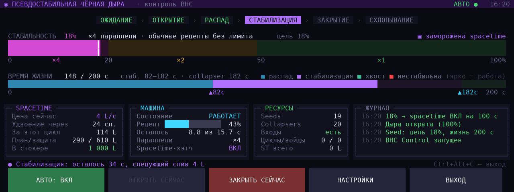
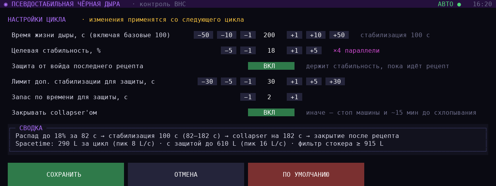

# BHC Control — Pseudostable Black Hole Containment Field (GTNH)

Программа для OpenComputers, которая автоматически управляет
[Pseudostable Black Hole Containment Field](https://wiki.gtnewhorizons.com/wiki/Pseudostable_Black_Hole_Containment_Field):
открывает дыру, держит её на целевой стабильности за spacetime, закрывает collapser'ом
и не даёт войднуться последнему рецепту. Интерфейс на русском, с тач-кнопками, рассчитан на экран T3 5×2.

Один компьютер управляет одним BHC.




## Железо

Раскладка **Method 1** с вики (Fox), без изменений:

| Блок | Что подключено | Сторона по умолчанию |
|---|---|---|
| Redstone I/O | wireless receiver («в подсети BHC есть входы», канал 1) | `west` |
| Redstone I/O | wireless transmitter → machine controller cover на stocking input hatch со spacetime | `east` |
| Redstone I/O | Black Hole Utility Hatch в режиме **PULSE** | `down` |
| Transposer | ME interface: слот 1 — Black Hole Seed, слот 2 — Black Hole Collapser | `east` |
| Transposer | Super Stock Replenisher со spacetime | `up` |
| Transposer | обычный input bus BHC | `down` |
| Adapter | MFU на контроллер BHC (до 16 блоков) | — |

Компьютер: T3 case, APU T3, RAM T3.5, HDD, OpenOS, **видеокарта T3 и экран T3 5×2** (разрешение 128×24).

Стороны и номера слотов задаются в таблице `HW` в начале `bhc.lua`. Если ничего не происходит, почти наверняка
перепутаны стороны.

## Установка

```
edit bhc.lua      -- вставить содержимое файла (средняя кнопка мыши), Ctrl+S, Ctrl+W
bhc
```

С интернет-картой:

```
wget https://raw.githubusercontent.com/EugenPrinz/pseudo_black_hole_program/main/bhc.lua
```

Настройки, сделанные на экране, хранятся в `/home/bhc.cfg`, там же статистика.

## Как работает цикл

1. **Ожидание.** Дыра открывается, если в подсети есть входы, в интерфейсе есть seed и collapser,
   а в стокере хватает spacetime на весь цикл с учётом защиты.
2. **Распад** от 100% до целевой стабильности (по умолчанию 18%, это зона ×4 параллели).
3. **Стабилизация.** Spacetime включён на `время жизни − 100` секунд. При 200 с это 100 сливов,
   **290 L** за цикл, пик 8 L/с.
4. **Закрытие.** Collapser отправляется в bus. Машина забирает его между рецептами, поэтому
   текущий рецепт всегда доделывается.
5. **Защита от войда.** Каждую секунду программа проверяет условие
   `осталось_рецепта + запас ≥ текущая_стабильность`. Пока оно выполняется, spacetime остаётся включённым
   (но не дольше «лимита защиты»). Как только времени хватает, spacetime выключается,
   чтобы не платить лишнее по удвоенной цене.
6. **Схлопывание.** Импульсы прекращаются, программа делает паузу 3 с и начинает следующий цикл.

Стабильность из машины прочитать нельзя, потому что OC её не отдаёт. Программа считает её сама по импульсам
utility hatch. Механика повторяет `MTEBlackHoleCompressor.java`: импульс раз в 20 тиков, k-й слив стоит
`2^floor((k−1)/30)` L, счётчик удвоения сбрасывается только при закрытии дыры.

### Восстановление и аварии

- **Запуск при уже открытой дыре** (например, после перезагрузки компьютера). Стабильность в этом случае
  неизвестна, поэтому дыра закрывается безопасно: collapser отправляется в bus, а spacetime включается,
  только пока идёт рецепт.
- **Импульсы пропали посреди цикла.** Включается тревога, spacetime выключается, автоматика встаёт на паузу.
  Сбросить тревогу можно кнопкой «АВТО».
- **Выход** (кнопка «ВЫХОД» дважды или Ctrl+Alt+C). Spacetime выключается. Если дыра открыта,
  collapser отправляется в bus.

## Настройки на экране

| Параметр | По умолчанию | Смысл |
|---|---|---|
| Время жизни дыры | 200 с | Включает базовые 100 с. Стабилизация длится `время − 100` с |
| Целевая стабильность | 18% | Ниже 20% даёт ×4 параллели, ниже 50% — ×2 |
| Защита от войда | ВКЛ | Держит стабильность, пока последний рецепт не закончится |
| Лимит защиты | 30 с | Максимум дополнительных сливов ради защиты |
| Запас по времени | 2 с | Страховка в расчёте защиты |
| Collapser | ВКЛ | Если выключить, машина останавливается, а дыра схлопывается сама (~15 мин) |

Экран настроек сразу показывает расход spacetime за цикл и рекомендуемый фильтр стокера.

## Ограничения

- Модель стабильности исходит из того, что spacetime действительно поступает, когда хэтч включён.
  Если стокер пуст, реальная стабильность упадёт, а программа об этом не узнает. Поэтому ставь фильтр
  стокера не ниже значения, рекомендованного в настройках.
- **SD MHDCSM и Blank Computational Singularity (900 с) не автоматизируй.** Вики советует делать их вручную.
  Рецепт длиннее `цель + лимит защиты` войднется.
- Чанк с BHC и компьютером должен быть загружен.

## Тесты

`tests/sim.lua` содержит офлайн-симулятор BHC, который потиково повторяет логику мода, и моки OpenComputers.

```
lua5.3 tests/sim.lua basic      # 3 цикла, рецепт 15.65 с
lua5.3 tests/sim.lua long       # рецепт 45 с — работает защита
lua5.3 tests/sim.lua recovery   # запуск при уже открытой дыре
lua5.3 tests/sim.lua starve     # входы закончились посреди цикла
lua5.3 tests/sim.lua touch      # тач: настройки, сохранение, ручное закрытие
lua5.3 tests/sim.lua screen     # текстовый дамп экранов
```

Результат: 0 войдов во всех сценариях. Модель spacetime в программе совпадает с реальным расходом машины
(290 L за цикл при 200 с).
